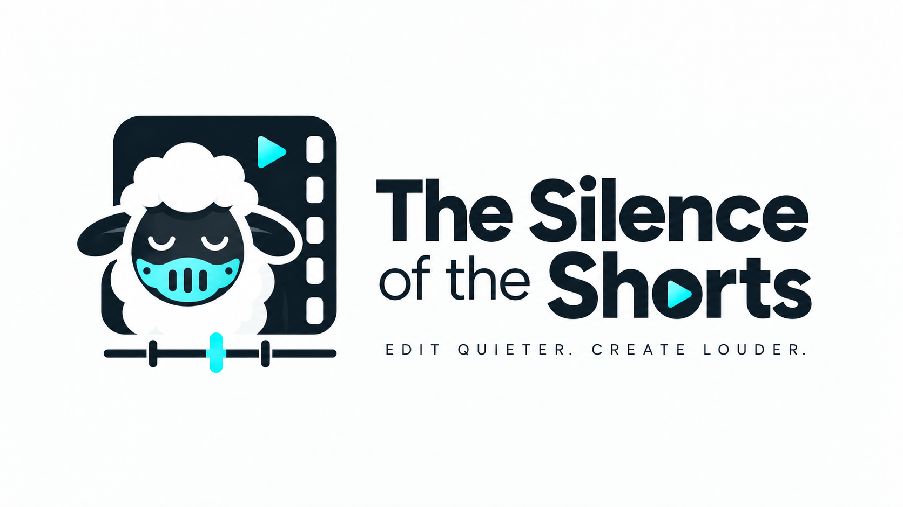

<p align="center"></p>

<p align="center"><a href="README.md">English</a> · <b>Español</b></p>

# The Silence of the Shorts

App de escritorio para Mac que deja un vídeo hablado listo para publicar:
limpia el ruido de la voz, recorta los silencios, quema subtítulos estilo
Reels y genera título, caption y hashtags con un modelo de IA local. Todo
en tu Mac, sin subir nada a ningún servicio.

| Entrada | Salida |
|---|---|
| `charla.mov` (cualquier vídeo con voz) | `charla_limpio.mp4` (voz limpia, sin silencios, subtítulos opcionales) |
| | `charla_limpio.srt` (subtítulos, si los activas) |
| | `charla_limpio.md` (título SEO, caption y hashtags, si lo activas) |

## Requisitos

- Mac con **Apple Silicon** (M1, M2, M3, M4…). Los Mac Intel no están soportados.
- **macOS 13** Ventura o posterior.
- **10 GB libres** en disco: entorno Python (2,5 GB), modelos de audio
  (0,7 GB) y, si quieres el caption SEO, el modelo de lenguaje (6 GB).
- Conexión a internet durante la instalación (descargas) y la primera vez
  que uses subtítulos. Después funciona sin conexión.
- Memoria: 16 GB es suficiente para todo salvo modelos de lenguaje grandes;
  la app te avisa de cuáles caben en tu Mac.

El instalador se ocupa de Homebrew, Python, ffmpeg, auto-editor y Ollama.
No hace falta saber programar.

## Instalación

1. Descarga la versión estable (rama **`main`**): el ZIP directo
   [tsots-main.zip](https://github.com/albercv/tsots/archive/refs/heads/main.zip),
   la [última Release](https://github.com/albercv/tsots/releases/latest) o
   `git clone -b main https://github.com/albercv/tsots.git`. Descomprímelo
   donde quieras dejarlo, por ejemplo en `~/Documents`. Ojo: el botón
   **Code → Download ZIP** de GitHub descarga la rama `develop`, que es
   trabajo en curso y puede no funcionar. **No muevas la carpeta después
   de instalar**; si lo haces, vuelve a ejecutar el instalador.
2. Doble clic en **`instalar.command`**. Si macOS dice que no se puede
   abrir porque es de un desarrollador no identificado: clic derecho →
   **Abrir** → **Abrir**. Se abre una ventana de Terminal.
3. Sigue lo que diga la Terminal. Pedirá tu contraseña una o dos veces
   (para Homebrew) y tardará entre 10 y 30 minutos según tu conexión.
   Cuando termine verás **Instalación completa**.

Al acabar tendrás el icono 🎬 **The Silence of the Shorts** en el Dock.

Si algo falla a mitad, vuelve a ejecutar `instalar.command`: retoma donde
lo dejó. Para desinstalar: `desinstalar.command`.

Variantes:

```bash
SIN_OLLAMA=1 ./instalar.command   # sin caption SEO (ahorra 6 GB)
SIN_DOCK=1 ./instalar.command     # sin icono en el Dock
```

## Primer arranque

- La app sigue el idioma del Mac (español o inglés). Puedes forzarlo con
  el selector 🌐 de abajo; pide confirmación y se reinicia (cancela
  cualquier proceso en marcha).
- macOS preguntará si la app puede acceder a **Documentos** (o a la
  carpeta donde tengas los vídeos). Acepta; si no, no podrá leerlos. Si
  lo negaste: Ajustes del Sistema → Privacidad y seguridad → Archivos y
  carpetas → The Silence of the Shorts.
- La primera vez que actives subtítulos o el caption descarga el modelo
  Whisper (~1,6 GB con turbo, el recomendado). Solo esa vez.

## Cómo funciona

1. **Arrastra** uno o varios vídeos a la zona de la izquierda (o haz clic
   para elegirlos). Aparecen en la cola.
2. **Elige opciones** a la derecha. Cada grupo es una sección plegable:
   pulsa su título para abrirla y se cierra la que estaba abierta (al
   arrancar, **Limpieza de audio**). Si no caben, solo las opciones hacen
   scroll; debajo, siempre a la vista, quedan las pestañas
   **Previsualización** y **Caption**.
   - **Pasos**: cada sección empieza con la casilla de su paso (mejorar
     audio, recortar silencios, subtítulos, caption, vertical) y se
     combinan como quieras; la cabecera lleva ✓ cuando el paso está activo.
     **Pipeline completo**, arriba, los marca todos de una vez (o los
     desmarca si ya estaban todos). Por defecto: audio y silencios.
   - **Limpieza de audio**: modelo de IA para quitar ruido. El de defecto
     (MossFormer2 48 kHz) es el mejor para voz.
   - **Corte de silencios**: margen que se deja alrededor de cada frase y
     umbral de volumen. "Acelerar" en vez de cortar los silencios los
     reproduce a la velocidad que indiques.
   - **Subtítulos**: diseño (8 a elegir: Reels bold, karaoke, karaoke
     verde, Impacto, amarillo, minimalista, caja negra y caja blanca),
     posición, tamaño, idioma y tamaño del modelo Whisper. La pestaña
     **Previsualización** te enseña cómo quedan sobre un fotograma real del
     vídeo seleccionado.
   - **Título al inicio** (casilla de la sección Subtítulos, activada por
     defecto): 3 a 5 palabras clave del vídeo, grandes y arriba, durante sus
     5 primeros segundos. Las escribe Ollama, con el mismo modelo del caption,
     a partir de la transcripción; sin Ollama el vídeo sale sin título y la
     fila muestra un aviso. La fuente, Titan One, va incluida con licencia OFL
     (`videopipeline/fuentes/OFL.txt`).
   - **Caption SEO**: genera `nombre_limpio.md` con título, caption y
     los 5 hashtags que mejor describen lo que se dice en el vídeo. **Marca…** guarda un
     texto con quién eres, tu tono y tu llamada a la acción para que el
     texto suene a ti. **Modelo** lista los modelos de Ollama instalados en
     tu Mac; los que no caben en memoria aparecen deshabilitados y el
     tooltip dice por qué.
   - **Formato vertical**: guarda además `nombre_limpio_vertical.mp4`
     (9:16, 1080x1920) para Reels y TikTok; si no marcas audio ni
     silencios, solo sale `nombre_vertical.mp4`. Encuadres: recorte central
     (por defecto), fondo difuminado (16:9), barras negras o **seguir la cara (4:3)**
     (más lento; la primera vez descarga el detector, ~90 MB). Se desmarca
     al reabrir la app: es un paso ocasional.
   - **Términos…**: tus marcas y nombres propios, uno por línea, para que
     Whisper los escriba bien en los subtítulos y el caption. Después de
     `=`, las formas en que Whisper se equivoca; se corrigen solas:

     ```
     Claude Code = Cloud Code, Claus Code
     Anthropic
     ```
3. **Salida**: por defecto junto al original como `nombre_limpio.mp4`;
   con **Cambiar…** eliges otra carpeta.
4. **▶ Procesar**. La cola avanza de uno en uno mostrando el paso
   (extrayendo audio, limpiando, recortando, transcribiendo…). Tarda
   aproximadamente lo que dura el vídeo. Mientras la app esté abierta el
   Mac no entra en reposo.
5. Al terminar, **doble clic** en un vídeo hecho lo abre. Si generaste
   caption, al seleccionarlo se abre la pestaña **Caption** con botones para
   copiar título, caption, hashtags o todo, y **Publicar…** (ver
   [Publicar en redes](#publicar-en-redes)).

Puedes seguir usando el Mac mientras procesa. Bloquear la pantalla no
detiene nada; cerrar la tapa sin monitor externo sí.

### Desde la terminal

```bash
./TheSilenceOfTheShorts.command                              # la misma app
.venv-clearvoice/bin/python limpiarVideo.py video.mov        # sin interfaz
.venv-clearvoice/bin/python limpiarVideo.py video.mov --caption --marca "Soy…"
```

## Volver a procesar un vídeo

Puedes añadir pasos a un vídeo que ya procesaste (por ejemplo, el recorte
de silencios que se te olvidó) sin perder lo que ya tiene y sin acabar con
`x_limpio_limpio.mp4`. Hay dos formas de repetir un vídeo:

- **Volver a procesar**: selecciona en la cola uno o varios vídeos
  terminados y pulsa el botón. Vuelven a "en espera"; marca los pasos que
  quieras en el panel y pulsa **▶ Procesar**.
- **Arrastrarlo otra vez**: sirve el original o cualquiera de sus
  resultados (`_limpio`, `_vertical`). La app reconoce que es el mismo
  vídeo y no crea una fila nueva.

**Qué recuerda la app.** De cada vídeo guarda una *ficha* en la carpeta
`fichas/` de la app, con lo que cuesta rehacer: el audio limpio, el vídeo
sin subtítulos (solo si el resultado lleva subtítulos quemados), la
transcripción, el caption y el seguimiento de la cara, además de los
ajustes con que se hizo cada cosa. Tus vídeos no se guardan ahí, salvo una
excepción: cuando la app sobrescribe por primera vez un resultado antiguo
(ver «Vídeos procesados antes de esta función»), guarda en la ficha la
versión anterior. Cada fila de la cola muestra los pasos que ya tiene el
vídeo (por ejemplo «✓ audio · silencios · subtítulos · caption») y cuánto
ocupan sus datos.

**Qué no se repite.**

- Un resultado se reutiliza mientras no cambie aquello de lo que depende:
  la limpieza de audio, la transcripción, el caption o el seguimiento de la
  cara no se vuelven a calcular si ya valen.
- Los resultados son siempre los mismos archivos y se sustituyen:
  `nombre_limpio.mp4`, `nombre_limpio_vertical.mp4` (o `nombre_vertical.mp4`
  si solo hay vertical), `.md` y `.srt`. `nombre` es siempre el del
  original.
- Desmarcar **Subtítulos** o **Caption** no borra los que ya existen.
- Los subtítulos nunca se queman encima de otros: se queman siempre sobre
  la versión sin subtítulos. Por eso, recortar silencios en un vídeo que ya
  tiene subtítulos los vuelve a transcribir y quemar; el caption se
  mantiene.
- **Solo caption** se puede pedir sobre un vídeo ya procesado: usa la
  transcripción que haya y no toca la imagen.
- **Publicar…** funciona con cualquier vídeo que tenga resultado y caption.
  Si falta el `.md` junto al vídeo, la app lo vuelve a escribir desde la
  ficha.
- Si cancelas o falla una pasada, los resultados anteriores quedan como
  estaban.

**Avisos.** Al pulsar **▶ Procesar**, la app revisa cada vídeo y, si ya
tiene algo de lo que marcaste, abre **Pasos ya hechos** antes de empezar:

- *«"x" ya tiene subtítulos»*: se mantiene tal como está. Marca
  **Rehacer** si el resultado no te gusta. Si lo ya hecho tiene otros
  ajustes que los del panel, el aviso dice qué cambia (por ejemplo,
  «estilo X → Y»).
- Un paso que cambia los tiempos (recortar silencios, limpiar el audio)
  explica qué se volverá a hacer y qué se mantiene.
- **Regenerar también el vertical**: si lo que cambias afecta al vertical y
  no lo regeneras, se queda como está y la fila lo marca como «vertical
  desactualizado».
- **Aplicar a todos los vídeos** copia tus marcas del primero al resto.
- Si no queda nada que hacer, la app lo dice y no lanza el proceso. Si
  falta el original y hace falta, avisa con su ruta y no toca nada.

Los ajustes de lo que se rehace sin que lo pidas (los subtítulos tras
recortar, un vertical desactualizado) son los guardados para ese vídeo:
estilo, idioma, modelo de Whisper y encuadre. El glosario y el contexto de
marca son siempre los de ahora.

**Olvidar este vídeo** borra la ficha de la fila seleccionada (base, audio
limpio, transcripción, seguimiento y copia del caption) y libera su
espacio. Nunca toca los resultados actuales ni sus `.md` y `.srt`, pero si
la ficha guarda la versión anterior de un resultado antiguo que se
sobrescribió, esa versión se borra con ella (la app te lo dice al pedir
confirmación). Los datos de una ficha se guardan hasta que la olvidas;
`desinstalar.command` borra `fichas/` entera, con esa versión incluida.

**Un vídeo cambiado o movido.** La app reconoce un archivo por su ruta,
tamaño y fecha. Si lo editas fuera de la app, te avisa y deja de usar lo
que se hizo a partir de él, pero no borra nada de su ficha. Un original
editado sigue en su ficha: se mantienen el caption y los resultados, y lo
demás se rehace desde el original nuevo. Un resultado editado empieza una
ficha nueva, y la anterior conserva todo lo demás (también una versión
anterior guardada). Si lo mueves o lo renombras, ya no lo reconoce. Nunca sobrescribe ni
borra un archivo que no escribió ella o que has cambiado: te dice cuál es
para que lo muevas o lo borres. La carpeta de salida que cambies en la app
solo se aplica a los vídeos sin resultados; los demás siguen escribiendo
donde ya están.

**Vídeos procesados antes de esta función.** No tienen ficha, así que la
app no sabe qué pasos se hicieron y no marca ninguno con ✓, salvo caption si
encontró su `.md` junto al vídeo.

- Si arrastras el original de un vídeo cuyo resultado ya está junto a él
  (`x_limpio.mp4`), la app adopta ese resultado: lo sobrescribirá en vez de
  crear una copia, y usa su `.md` y su `.srt`, si existen, como caption y
  transcripción. Un `x_limpio_vertical.mp4` de antes también se adopta
  (aunque ya no esté el `x_limpio.mp4`), marcado como desactualizado porque
  no se sabe cómo se hizo. Un original sin resultado previo es un vídeo
  nuevo, igual que cualquier otro.
- Ese resultado puede ser de otro vídeo con el mismo nombre (las cámaras
  repiten nombres), así que la app avisa de que usará su caption. Si no es
  de este vídeo, muévelo a otra carpeta y usa **Olvidar este vídeo**. Un
  resultado que dura más que el original (más de un segundo) no puede ser
  suyo: no se adopta y el vídeo nuevo se llama `x (2)` para no pisarlo.
- Si arrastras un resultado antiguo sin su original (`x_limpio.mp4`,
  `x_vertical.mp4`, `x_limpio_limpio.mp4`…), pasa a ser el resultado de ese
  vídeo y se sobrescribe a sí mismo; nunca escribe en otra versión antigua.
  La primera vez que lo sobrescribe, guarda su versión anterior en la
  ficha (es la excepción de arriba).
- En ese caso, si junto al resultado hay un `.srt`, la app da por hecho que los
  subtítulos están quemados y que no existe una versión sin ellos: no puede
  rehacerlos ni hacer un vertical con subtítulos hasta que arrastres el
  original («Arrastra el original para rehacerlos»). Lo demás sí se
  permite; recortar silencios corta imagen y subtítulos a la vez. Si luego
  arrastras el original verdadero, se une a ese resultado en vez de crear
  otro, aunque la app ya lo haya sobrescrito, y entonces sí puede
  rehacerlos. La versión anterior guardada se queda en la ficha. Lo que se
  calculó a partir del resultado antiguo (audio limpio, recorte,
  transcripción, seguimiento de la cara) tiene sus tiempos y se rehace
  desde el original; el caption se mantiene.
- Las copias duplicadas que ya tengas (`x_limpio_limpio.mp4`…) no se
  borran: bórralas tú.

## Publicar en redes

Desde un vídeo terminado con caption, **Publicar…** lo envía a **TikTok →
YouTube → Instagram → X → Facebook**, en ese orden. Nunca se publica nada
solo: revisas título, caption, hashtags y el texto para X, marcas las
plataformas, pulsas **Publicar** y confirmas. Si una plataforma falla, las demás siguen; cada fila muestra su
progreso y, al terminar, el enlace o el error.

TikTok y YouTube solo dejan publicar en público a apps auditadas, así que
TSOTS publica a través de un servicio que ya tiene ese permiso:
**Upload-Post** ([upload-post.com](https://www.upload-post.com), plan
gratuito de 10 subidas al mes). Necesitas:

1. Una cuenta en Upload-Post.
2. En Upload-Post, un **perfil** con tus redes conectadas (TikTok,
   YouTube, Instagram, X, Facebook: las que uses). La cuenta de Instagram
   debe ser **profesional** (empresa o creador). En Facebook solo se puede
   publicar en una **página**, no en un perfil personal.
3. La **API key** de Upload-Post.

No está claro si X y Facebook entran en el plan gratuito de Upload-Post:
si no, la fila de esa plataforma muestra el error del servicio y las
demás siguen.

Guárdalos una vez en **Redes…** (barra inferior, junto al idioma; siempre
visible, también desde Publicar…): el nombre del perfil
y la API key. La clave va directa al **Llavero de macOS** (servicio
`tsots-upload_post`); la app nunca la muestra ni la escribe en disco. Para
quitarla: **Olvidar clave** en el mismo diálogo, o borra la entrada en
Acceso a Llaveros.

**Comprobar conexión** (en Redes…) pregunta a Upload-Post qué cuentas
tienes conectadas y en qué páginas de Facebook puedes publicar: elige ahí
la página (si solo hay una, se elige sola). Al abrir Publicar… se vuelve a
comprobar en segundo plano: una red sin conectar aparece deshabilitada
(«No conectada en Upload-Post») y una que hay que reconectar, con un
aviso. Sin conexión se usa lo último que se supo.

**Límites de X.** Un post de X admite **280 caracteres** (una URL cuenta
23 y un emoji, 2). Publicar… propone un texto para X con el título y los
hashtags (quita hashtags desde el final y, si hace falta, acorta el
título); puedes editarlo y el contador muestra cuánto ocupa. Sin Premium,
X solo admite vídeos de hasta **2:20** y **512 MB**: con un vídeo más
largo o más pesado, X aparece deshabilitada con el motivo. Si tu cuenta
tiene Premium, márcalo en Redes… («Mi cuenta de X tiene Premium»): se
admiten vídeos largos y textos largos en un solo post. Si Upload-Post
indica que la cuenta es Premium, la casilla se marca sola al comprobar la
conexión.

Qué hace cada modo:

| Plataforma | Modo | Resultado |
|---|---|---|
| TikTok | **Borrador** (por defecto) | El vídeo llega a tus borradores de TikTok; lo terminas y publicas en la app. |
| TikTok | **Público** | Se publica al momento, visible para todos. |
| YouTube | **Short público** | Se publica como Short público en la categoría elegida en Redes… (Personas y blogs por defecto). |
| Instagram | **Reel de prueba** (por defecto) | Se enseña primero a quien no te sigue; Instagram lo comparte con tus seguidores solo si funciona. |
| Instagram | **Reel normal** | Un reel normal, también en tu feed. |
| X | **Post público** | Un post con el vídeo y el texto para X; nunca un hilo. |
| Facebook | **Reel** (por defecto) | Un reel publicado en tu página. |
| Facebook | **Vídeo normal** | Un vídeo publicado en tu página. |
| Facebook | **Borrador** | Un reel sin publicar; lo terminas en Facebook. |

**Ubicación.** Las publicaciones salen etiquetadas en **Madrid** salvo que
elijas otra cosa en Redes… (fila **Ubicación** de «Al publicar», botón
**Cambiar…**). Para un solo vídeo, pulsa **Cambiar…** junto a «Ubicación»
en el diálogo Publicar: la de siempre no cambia.

Eliges la **ciudad** en una lista (o «Sin ubicación»); nunca ves ni
escribes IDs. Solo TikTok, Instagram y X admiten ubicación:

- **Instagram y X:** cada ciudad de la lista trae sus IDs de lugar. Son del
  lugar, no de tu cuenta: valen igual para cualquiera que publique allí.
  La lista tiene las 15 ciudades más grandes de España: Madrid, Barcelona,
  Valencia, Sevilla, Zaragoza, Málaga, Murcia, Palma, Las Palmas de Gran
  Canaria, Alicante, Bilbao, Córdoba, Valladolid, Vigo y Granada. Todas
  llevan Instagram y X salvo Murcia, que solo lleva X. Añadir otra ciudad
  es un cambio en la app (ver `docs/DEVELOPMENT.md`, «Location»).
- **TikTok:** su lugar es de tu cuenta, así que no viene en la lista. Al
  publicar se busca el que se llame como la ciudad; si quieres uno
  concreto, pulsa **Buscar en TikTok** y elígelo. Ese lugar es un dato
  privado: se guarda solo en el Llavero de macOS, nunca en los ajustes, en
  los registros ni en ningún repositorio. Tu cuenta de TikTok necesita
  permiso para ubicaciones: si no lo tiene, TSOTS te pide reconectarla en
  Upload-Post.

Si algo de la ubicación falla, la publicación sigue adelante sin ella.

TSOTS apunta cada publicación en `nombre_limpio.publicado.json`, junto al
vídeo (plataforma, fecha, enlace, servicio). Si vuelves a abrir Publicar
con ese vídeo, avisa de que ya se publicó.

**Programar.** En la fila **Cuándo** del diálogo Publicar eliges
**Ahora** (lo de siempre) o **Programar** con una fecha y una hora, en la
hora de tu Mac. La misma fecha vale para todas las redes marcadas: al
menos 15 minutos después de ahora y como mucho a un año. El botón pasa a
llamarse **Programar**. Al pulsarlo, el vídeo se sube a Upload-Post en ese
momento y Upload-Post lo publica a la hora elegida, así que después puedes
cerrar la app o apagar el Mac. Cada red respeta su modo (un TikTok en
borrador llega a tus borradores a esa hora). Upload-Post gasta el crédito
al programar y lo devuelve si cancelas antes de la hora.

**Programadas…** (barra inferior, junto a Redes…) abre un calendario del
mes con todo lo pendiente en Upload-Post, también lo que programes desde
su web. Cada día muestra la hora, las siglas de las redes (TT, YT, IG, X,
FB) y el título. Al pulsar una etiqueta ves cada red con su botón
**Cancelar** (y **Cancelar todas**). Cancelar pide confirmación; si el
vídeo se programó desde TSOTS, Publicar deja de avisar de que ya está
programado. Para cambiar la fecha, cancela y vuelve a programar.

## Si algo va mal

- Una fila en **rojo** en la cola es un vídeo que ha fallado. **Doble clic**
  sobre ella: verás la causa, qué hacer y un botón **Abrir log** con todo
  el detalle. Los logs están en `logs/`.
- Una fila con **⚠** ha terminado, pero con un aviso (por ejemplo, los
  subtítulos o el caption fallaron y el vídeo se guardó sin ellos). Pasa
  el ratón por encima para leerlo.
- "**Faltan dependencias**" al abrir: vuelve a ejecutar `instalar.command`.
- El **caption** no se genera: comprueba que la app de Ollama esté abierta
  (icono en la barra de menú) y pulsa ↻ junto al selector de modelo. Para
  añadir modelos: `ollama pull nombre` en Terminal y luego ↻.
- Tras actualizar Homebrew (Python) la app se reconstruye sola al
  arrancar (tarda unos segundos más esa vez). Si aun así no abre, ejecuta
  `instalar.command` de nuevo.

## Qué usa por dentro

[ClearVoice](https://github.com/modelscope/ClearerVoice-Studio) (limpieza de
voz, Apache-2.0), [auto-editor](https://auto-editor.com) (silencios),
[mlx-whisper](https://github.com/ml-explore/mlx-examples/tree/main/whisper)
(transcripción con la GPU del Mac; faster-whisper en macOS 13),
ffmpeg (vídeo), [Ollama](https://ollama.com) (modelo de lenguaje local),
[Upload-Post](https://www.upload-post.com) (publicar, opcional), PySide6 (interfaz). Documentación técnica en `docs/DEVELOPMENT.md` (en inglés).

Licencia: Apache-2.0 (ver `LICENSE`). Incluye código de ClearerVoice-Studio,
© Alibaba, bajo la misma licencia.
