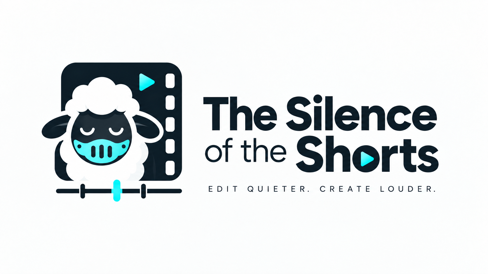

<p align="center"></p>

<p align="center"><b>English</b> · <a href="README.es.md">Español</a></p>

# The Silence of the Shorts

A Mac desktop app that gets a talking-head video ready to publish: it
cleans the noise out of the voice, cuts the silences, burns Reels-style
subtitles and writes an SEO title, caption and hashtags with a local AI
model. Everything runs on your Mac; nothing is uploaded anywhere.

| Input | Output |
|---|---|
| `talk.mov` (any video with speech) | `talk_limpio.mp4` (clean voice, no silences, optional subtitles) |
| | `talk_limpio.srt` (subtitles, if enabled) |
| | `talk_limpio.md` (SEO title, caption and hashtags, if enabled) |

## Requirements

- Mac with **Apple Silicon** (M1, M2, M3, M4…). Intel Macs are not supported.
- **macOS 13** Ventura or later.
- **10 GB free** on disk: Python environment (2.5 GB), audio models
  (0.7 GB) and, if you want the SEO caption, the language model (6 GB).
- Internet during installation (downloads) and the first time you use
  subtitles. After that it works offline.
- Memory: 16 GB is enough for everything except large language models;
  the app tells you which ones fit on your Mac.

The installer takes care of Homebrew, Python, ffmpeg, auto-editor and
Ollama. No programming knowledge needed.

## Installation

1. Download the stable version (**`main`** branch): the direct ZIP
   [tsots-main.zip](https://github.com/albercv/tsots/archive/refs/heads/main.zip),
   the [latest Release](https://github.com/albercv/tsots/releases/latest) or
   `git clone -b main https://github.com/albercv/tsots.git`. Unzip it where
   you want to keep it, for example in `~/Documents`. Note: GitHub's
   **Code → Download ZIP** button downloads the `develop` branch, which is
   work in progress and may not work. **Do not move the folder after
   installing**; if you do, run the installer again.
2. Double-click **`instalar.command`**. If macOS says it cannot be opened
   because it is from an unidentified developer: right-click → **Open**
   → **Open**. A Terminal window opens.
3. Follow the Terminal. It will ask for your password once or twice (for
   Homebrew) and take 10 to 30 minutes depending on your connection. When
   it finishes you will see **Installation complete**.

You will end up with the 🐑 **The Silence of the Shorts** icon in the Dock.

If something fails halfway, run `instalar.command` again: it resumes
where it stopped. To uninstall: `desinstalar.command`.

Variants:

```bash
SIN_OLLAMA=1 ./instalar.command   # without SEO caption (saves 6 GB)
SIN_DOCK=1 ./instalar.command     # without the Dock icon
```

## First launch

- The app follows your Mac's language (English or Spanish). You can force
  one with the 🌐 selector at the bottom of the window; the app asks for
  confirmation and restarts (any process in progress is cancelled).
- macOS will ask whether the app may access **Documents** (or wherever
  your videos are). Accept; otherwise it cannot read them. If you
  declined: System Settings → Privacy & Security → Files and Folders →
  The Silence of the Shorts.
- The first time you enable subtitles or the caption it downloads the
  Whisper model (~1.6 GB with turbo, the recommended one). Only once.

## How it works

1. **Drag** one or more videos onto the area on the left (or click to
   choose them). They appear in the queue.
2. **Pick options** on the right. Each group is a collapsible section:
   click its title to open it and the open one closes (**Audio cleaning**
   at startup). If they do not fit, only the options scroll; below them,
   always visible, sit the **Preview** and **Caption** tabs.
   - **Steps**: each section starts with the checkbox of its step (enhance
     audio, cut silences, subtitles, caption, vertical) and they combine
     freely; the header shows ✓ when the step is on. **Full pipeline**, at
     the top, ticks them all at once (or clears them if they were all on).
     Default: audio and silences.
   - **Audio cleaning**: AI model that removes noise. The default
     (MossFormer2 48 kHz) is the best for voice.
   - **Silence cutting**: margin kept around each sentence and volume
     threshold. "Speed up" plays the silences faster instead of cutting
     them.
   - **Subtitles**: style (8 to choose from: Reels bold, karaoke, green
     karaoke, Impact, yellow, minimal, black box and white box), position,
     size, language and Whisper model size. The **Preview** tab shows how they
     look on a real frame of the selected video.
   - **Opening title** (checkbox in the Subtitles section, on by default):
     3 to 5 keywords from the video, large at the top during its first 5
     seconds. Ollama writes them from the transcript, with the caption's
     model; without Ollama the video is saved with no title, and the row
     shows a warning. The font, Titan One, is bundled under the SIL Open Font
     License (`videopipeline/fuentes/OFL.txt`).
   - **SEO caption**: writes `name_limpio.md` with a title, caption and
     the 5 hashtags that best describe what is said in the video. **Brand…** stores a text
     about who you are, your tone and your call to action so the copy
     sounds like you. **Model** lists the Ollama models installed on your
     Mac; the ones that do not fit in memory appear disabled and the
     tooltip says why. The caption is written in the subtitle language.
   - **Vertical format**: also saves `name_limpio_vertical.mp4` (9:16,
     1080x1920) for Reels and TikTok; without audio or silences selected,
     only `name_vertical.mp4` is written. Framings: centre crop (default),
     blurred background (16:9), black bars or **follow the face (4:3)** (slower; the
     first time it downloads the detector, ~90 MB). It is unticked when the
     app reopens: it is an occasional step.
   - **Terms…**: your brands and proper names, one per line, so Whisper
     spells them right in the subtitles and the caption. After `=`, the
     ways Whisper gets them wrong; they are fixed automatically:

     ```
     Claude Code = Cloud Code, Claus Code
     Anthropic
     ```
3. **Output**: next to the original as `name_limpio.mp4` by default;
   **Change…** picks another folder.
4. **▶ Process**. The queue advances one video at a time, showing the
   step (extracting audio, cleaning, cutting, transcribing…). It takes
   roughly as long as the video lasts. The Mac will not sleep while the
   app is open.
5. When done, **double-click** a finished video to open it. If you
   generated a caption, selecting the video opens the **Caption** tab with
   buttons to copy the title, caption, hashtags or everything, and
   **Publish…** (see
   [Publish to social networks](#publish-to-social-networks)).

You can keep using the Mac while it processes. Locking the screen does
not stop anything; closing the lid without an external display does.

### From the terminal

```bash
./TheSilenceOfTheShorts.command                              # the same app
.venv-clearvoice/bin/python limpiarVideo.py video.mov        # no GUI
.venv-clearvoice/bin/python limpiarVideo.py video.mov --caption --marca "I am…"
TSOTS_LANG=en ./TheSilenceOfTheShorts.command                # force a language
```

## Process a video again

You can add steps to a video you already processed (say, the silence
cutting you forgot) without losing what it already has and without ending
up with `x_limpio_limpio.mp4`. There are two ways to repeat a video:

- **Process again**: select one or more finished videos in the queue and
  press the button. They go back to "waiting"; tick the steps you want in
  the panel and press **▶ Process**.
- **Drag it in again**: either the original or any of its results
  (`_limpio`, `_vertical`) works. The app recognises it is the same video
  and does not add a new row.

**What the app remembers.** For each video it keeps a *record* in the
app's `fichas/` folder, holding what is costly to redo: the cleaned audio,
the video without subtitles (only when the result has subtitles burned
in), the transcript, the caption and the face tracking, plus the settings
each one was made with. Your videos are not stored there, with one
exception: when the app overwrites an old result for the first time (see
"Videos processed before this feature"), it keeps the previous version in
the record. Each queue row shows the steps the video already has (for
example "✓ audio · silences · subtitles · caption") and how much its data
takes up.

**What is not repeated.**

- A result is reused as long as what it depends on has not changed: the
  audio cleaning, the transcript, the caption or the face tracking are not
  computed again if they are still valid.
- Results are always the same files and are replaced: `name_limpio.mp4`,
  `name_limpio_vertical.mp4` (or `name_vertical.mp4` if there is only a
  vertical), `.md` and `.srt`. `name` is always the original's.
- Unticking **Subtitles** or **Caption** does not delete the ones that
  already exist.
- Subtitles are never burned on top of other subtitles: they are always
  burned onto the version without subtitles. So cutting silences in a
  video that already has subtitles transcribes and burns them again; the
  caption is kept.
- **Caption only** can be requested on an already processed video: it uses
  whatever transcript exists and does not touch the picture.
- **Publish…** works with any video that has a result and a caption. If the
  `.md` next to the video is missing, the app writes it again from the
  record.
- If a pass is cancelled or fails, the previous results stay as they were.

**Warnings.** When you press **▶ Process**, the app checks each video and,
if it already has something you ticked, opens **Steps already done**
before starting:

- *"x" already has subtitles*: it is kept as it is. Tick **Redo** if you
  do not like the result. If what exists was made with other settings than
  the panel's, the warning says what changes (for example, "style X → Y").
- A step that changes the timing (cutting silences, cleaning the audio)
  explains what will be redone and what is kept.
- **Also regenerate the vertical version**: if what you change affects the
  vertical and you do not regenerate it, it stays as it is and the row
  marks it "vertical out of date".
- **Apply to all videos** copies your ticks from the first video to the
  rest.
- If nothing is left to do, the app says so and does not start the
  process. If the original is missing and needed, it warns you with its
  path and touches nothing.

What gets redone without you asking (the subtitles after cutting, an
outdated vertical) uses the settings saved for that video: style,
language, Whisper model and framing. The terms list and the brand context
are always the current ones.

**Forget this video** deletes the record of the selected row (base, cleaned
audio, transcript, tracking and the caption copy) and frees its space. It
never touches the current results or their `.md` and `.srt`, but if the
record holds the previous version of an old result that was overwritten,
that version is deleted with it (the app tells you when it asks for
confirmation). A record's data is kept until you forget it;
`desinstalar.command` deletes the whole `fichas/` folder, that version
included.

**A video that was changed or moved.** The app recognises a file by its
path, size and date. If you edit it outside the app, it warns you and stops
using what was made from it, but deletes nothing from its record. An edited
original stays in its record: the caption and the results are kept, and the
rest is redone from the new original. An edited result starts a new record,
and the earlier one keeps everything else (a saved previous version too).
If you move or rename it, it no longer recognises it.
It never overwrites or deletes a file it did not write or that you have
changed: it tells you which one, so you can move or delete it. The output
folder you change in the app only applies to videos without results; the
others keep writing where they already are.

**Videos processed before this feature.** They have no record, so the app
does not know which steps were done and ticks none with ✓, except caption
when it found its `.md` next to the video.

- If you drag in the original of a video whose result is already next to
  it (`x_limpio.mp4`), the app adopts that result: it will overwrite it
  instead of creating a copy, and uses its `.md` and `.srt`, if they exist,
  as the caption and transcript. An older `x_limpio_vertical.mp4` is also
  adopted (even when the `x_limpio.mp4` is gone), marked out of date
  because nobody knows how it was made. An original with no earlier result
  is a new video, like any other.
- That result may belong to another video with the same name (cameras
  reuse names), so the app warns that it will use its caption. If it is
  not from this video, move it to another folder and use **Forget this
  video**. A result longer than the original (by more than a second) cannot
  be its own: it is not adopted, and the new video is named `x (2)` so it
  does not overwrite it.
- If you drag in an old result without its original (`x_limpio.mp4`,
  `x_vertical.mp4`, `x_limpio_limpio.mp4`…), it becomes that video's result
  and overwrites itself; it never writes into another old version. The
  first time it overwrites it, it keeps the previous version in the record
  (the exception above).
- In that case, if there is an `.srt` next to the result, the app assumes
  the subtitles are burned in and that no version without them exists: it
  cannot redo them or make a vertical with subtitles until you drag in the
  original ("Drag in the original to redo them"). Everything else is
  allowed; cutting silences cuts the picture and the subtitles together. If
  you later drag in the real original, it joins that result instead of
  creating another one, even after the app has overwritten it, and then it
  can redo them. The saved previous version stays in the record. What was
  computed from the old result (cleaned audio, cut, transcript, face
  tracking) has its timing and is redone from the original; the caption is
  kept.
- The duplicate copies you already have (`x_limpio_limpio.mp4`…) are not
  deleted: delete them yourself.

## Publish to social networks

From a finished video with a caption, **Publish…** sends it to **TikTok →
YouTube → Instagram → X → Facebook**, in that order. Nothing is published
automatically: you review the title, caption, hashtags and the text for
X, tick the platforms, press **Publish** and confirm. A failure on one platform does not stop the
others; each row shows its progress and, at the end, a link or the error.

TikTok and YouTube only let audited apps post publicly, so TSOTS publishes
through a service that already has that approval: **Upload-Post**
([upload-post.com](https://www.upload-post.com), free plan with 10
uploads a month). Requirements:

1. An Upload-Post account.
2. In Upload-Post, a **profile** with your networks connected (TikTok,
   YouTube, Instagram, X, Facebook: the ones you use). Instagram must be a
   **professional** account (Business or Creator). On Facebook you can
   only post to a **Page**, not to a personal profile.
3. Your Upload-Post **API key**.

It is not clear whether X and Facebook are part of Upload-Post's free
plan: if they are not, that platform's row shows the service's error and
the others carry on.

Save them once in **Networks…** (bottom bar, next to the language; always
visible, also reachable from Publish…): the profile name and
the API key. The key goes straight to the **macOS Keychain** (service
`tsots-upload_post`); the app never shows it or writes it to disk. To
remove it: **Forget key** in the same dialog, or delete the entry in
Keychain Access.

**Check connection** (in Networks…) asks Upload-Post which accounts you
have connected and which Facebook Pages you can post to: pick the Page
there (if there is only one, it is picked for you). When Publish… opens
it checks again in the background: a network that is not connected is
disabled ("Not connected in Upload-Post") and one that needs
reconnecting shows a warning. Offline, the last known result is used.

**X limits.** An X post takes **280 characters** (a URL counts 23 and an
emoji 2). Publish… suggests a text for X made of the title and the
hashtags (it drops hashtags from the end and, if needed, shortens the
title); you can edit it and the counter shows its length. Without
Premium, X only accepts videos up to **2:20** and **512 MB**: with a
longer or heavier video, X is disabled with the reason. If your account
has Premium, tick it in Networks… ("My X account has Premium"): long
videos and long texts in a single post are then allowed. If Upload-Post
reports the account as Premium, the box is ticked for you when you check
the connection.

What each mode does:

| Platform | Mode | Result |
|---|---|---|
| TikTok | **Draft** (default) | The video lands in your TikTok drafts; you finish and publish it in the app. |
| TikTok | **Public** | Published straight away, visible to everyone. |
| YouTube | **Public Short** | Published as a public Short in the category chosen in Networks… (People & Blogs by default). |
| Instagram | **Trial reel** (default) | Shown to non-followers first; Instagram shares it with your followers only if it performs. |
| Instagram | **Regular reel** | A normal reel, also shown in your feed. |
| X | **Public post** | A post with the video and the text for X; never a thread. |
| Facebook | **Reel** (default) | A reel published on your Page. |
| Facebook | **Regular video** | A video published on your Page. |
| Facebook | **Draft** | An unpublished reel; you finish it in Facebook. |

**Location.** Posts are tagged with **Madrid** unless you choose otherwise
in Networks… (**Location** row under "When publishing", **Change…**
button). For a single video, press **Change…** next to "Location" in the
Publish dialog: the usual one stays as it is.

You pick the **city** from a list (or "No location"); you never see or type
IDs. Only TikTok, Instagram and X support a location:

- **Instagram and X:** each city in the list comes with its place IDs.
  They belong to the place, not to your account: they work the same for
  anyone posting there. The list has the 15 biggest Spanish cities:
  Madrid, Barcelona, Valencia, Sevilla, Zaragoza, Málaga, Murcia, Palma,
  Las Palmas de Gran Canaria, Alicante, Bilbao, Córdoba, Valladolid, Vigo
  and Granada. All of them carry Instagram and X except Murcia, which only
  carries X. Adding another city is a change in the app (see
  `docs/DEVELOPMENT.md`, "Location").
- **TikTok:** its place belongs to your account, so it is not in the list.
  When publishing, the place named like the city is looked up; to use a
  specific one, press **Search TikTok** and pick it. That place is private
  data: it is only stored in the macOS Keychain, never in the settings, the
  logs or any repository. Your TikTok account needs the location
  permission: if it lacks it, TSOTS asks you to reconnect it in
  Upload-Post.

If anything about the location fails, the post goes ahead without it.

TSOTS writes `name_limpio.publicado.json` next to the video (platform,
date, link, service). If you open Publish again for that video, it warns
you that it was already published.

**Scheduling.** In the **When** row of the Publish dialog, choose **Now**
(as before) or **Schedule** with a date and time in your Mac's time zone.
The same time applies to every ticked network: at least 15 minutes from
now and at most a year ahead. The button becomes **Schedule**. When you
press it, the video is uploaded to Upload-Post right away and Upload-Post
publishes it at the chosen time, so afterwards you can quit the app or
turn off the Mac. Each network keeps its mode (a TikTok draft reaches your
drafts at that time). Upload-Post spends the credit when you schedule and
refunds it if you cancel before the time.

**Scheduled…** (bottom bar, next to Networks…) opens a month calendar with
everything pending in Upload-Post, including what you schedule on its
website. Each day shows the time, the networks' initials (TT, YT, IG, X,
FB) and the title. Click a label to see each network with its **Cancel**
button (and **Cancel all**). Cancelling asks for confirmation; if the video
was scheduled from TSOTS, Publish stops warning that it is already
scheduled. To change the time, cancel and schedule again.

## If something goes wrong

- A **red** row in the queue is a failed video. **Double-click** it: you
  get the cause, what to do, and an **Open log** button with the full
  detail. Logs live in `logs/`.
- A row with **⚠** finished, but with a warning (for example, subtitles
  or the caption failed and the video was saved without them). Hover to
  read it.
- "**Missing dependencies**" on launch: run `instalar.command` again.
- The **caption** is not generated: check that the Ollama app is open
  (menu bar icon) and press ↻ next to the model selector. To add models:
  `ollama pull name` in Terminal, then ↻.
- After a Homebrew (Python) upgrade the app rebuilds itself on launch (a
  few seconds longer that one time). If it still does not open, run
  `instalar.command` again.

## What is inside

[ClearVoice](https://github.com/modelscope/ClearerVoice-Studio) (voice
cleaning, Apache-2.0), [auto-editor](https://auto-editor.com) (silences),
[mlx-whisper](https://github.com/ml-explore/mlx-examples/tree/main/whisper)
(transcription on the Apple GPU; faster-whisper on macOS 13), ffmpeg (video), [Ollama](https://ollama.com) (local
language model), [Upload-Post](https://www.upload-post.com) (publishing,
optional), PySide6 (interface). Technical docs in
`docs/DEVELOPMENT.md`; translations live in `locale/` (add a language by
adding a `.po` file — see the development docs).

License: Apache-2.0 (see `LICENSE`). Includes code from
ClearerVoice-Studio, © Alibaba, under the same license.
